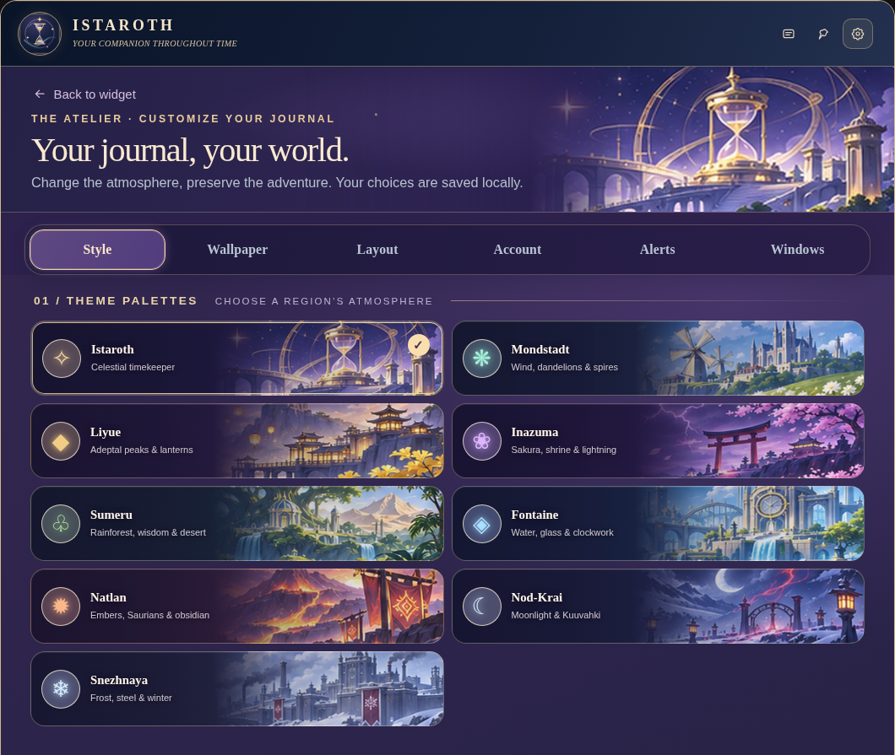
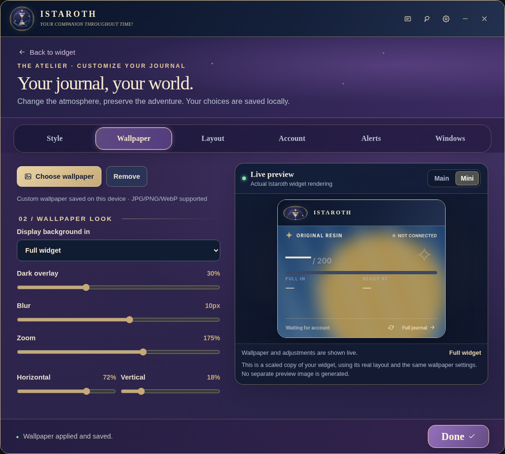
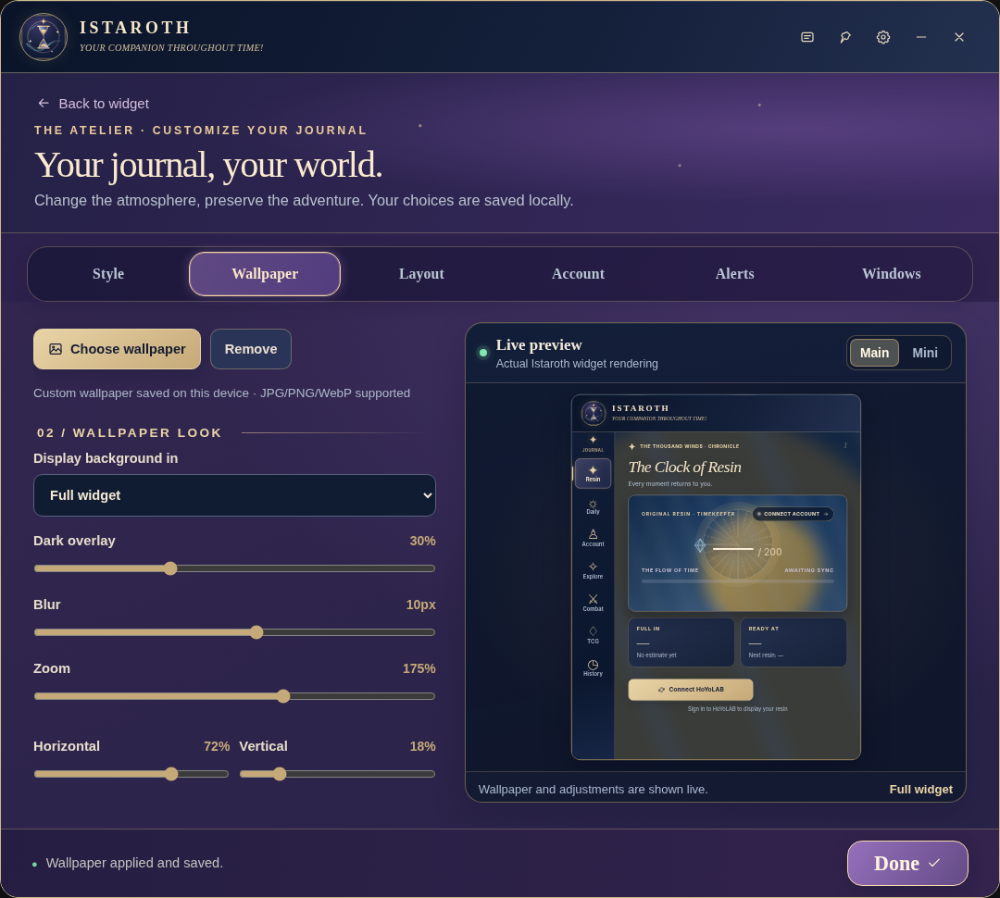

# Istaroth

**Your Companion Throughout Time!**

A free, open-source, unofficial **Genshin Impact** companion for Windows. Check Original Resin and recovery time without launching the game, pin a compact Mini Widget, and personalize your desktop with region-inspired themes.

[**Download Istaroth 1.0 for Windows**](https://github.com/Subaru771/Istaroth/releases/tag/1.0) · [Check installer SHA-256](checksums/Istaroth_Setup_v1.0.exe.sha256) · [Report an issue](https://github.com/Subaru771/Istaroth/issues/new)

> **First public release:** Windows 10/11 (64-bit). The current installer is **unsigned** and has **not undergone an independent security audit**. Installation requires internet access for the pinned Electron runtime. Istaroth is not affiliated with HoYoverse or Cognosphere.

## See Istaroth

**Choose from nine designs**



**Customize Mini and Main wallpaper independently**





The Mini Widget screenshot demonstrates offline rendering with no account connected. It does **not** represent a live Resin sync.

## What you get

- **Original Resin:** HoYoLAB-sourced information, recovery estimates, tray indicator, reminders and quiet hours.
- **Two widget modes:** Full Main Widget and compact floating Mini Widget, with always-on-top and minimize-to-tray behavior.
- **Three independent wallpapers:** Main background, Resin Card and Mini Widget each have their own image, darkness, blur, zoom and position controls.
- **Nine themed styles:** Istaroth, Mondstadt, Liyue, Inazuma, Sumeru, Fontaine, Natlan, Nod-Krai and Snezhnaya. Regional illustrations appear in the Style gallery.
- **Personalization:** Fonts, accent colors, layout controls and saved appearance preferences.
- **Activity overview:** Local Resin history and additional HoYoLAB panels when available; unsupported or unavailable endpoints may fail.
- **Windows integration:** Startup preferences and a graphical uninstaller.

Istaroth does not launch or modify the game and does not provide manual Resin editing.

## Install

1. Visit [the official release](https://github.com/Subaru771/Istaroth/releases/tag/1.0) and download **`Istaroth_Setup_v1.0.exe`**.
2. Optionally verify the file's [SHA-256 checksum](checksums/Istaroth_Setup_v1.0.exe.sha256). A checksum detects changed bytes; it is **not** a code signature.
3. Quit any existing Istaroth/Teyvat Pulse tray instance, then run the graphical installer. On first installation it downloads **Electron 45.1.0 from its official GitHub release** and checks a pinned SHA-256.
4. Launch Istaroth and select **Settings → Account → Connect HoYoLAB** to sign in on the **official HoYoLAB page**.
5. Customize **Settings → Style**, **Main wallpaper**, **Mini wallpaper**, **Alerts** and **Windows**.

**Known installation caveats:** The EXE is currently unsigned and may trigger SmartScreen. An actual antivirus malware warning should be investigated independently rather than bypassed. The installer has not been independently audited. A network connection is needed for first installation.

## HoYoLAB security and privacy

- Sign-in opens the official HoYoLAB website in a dedicated, persistent Electron browser session; the app has no separate login/password collection form.
- The app **does access authentication cookies locally** to make authenticated requests. Its current API client limits those requests to an explicit HoYoLAB/HoYoverse host allowlist.
- Session data stays in the local Chromium profile; no Istaroth-operated analytics, authentication or telemetry server is configured. Authentication requests **do** go to HoYoLAB/HoYoverse.
- Only install software you trust with your account session. Don't share session cookies, tokens or screenshots containing them.
- Sign-out clears the dedicated Electron login partition. Your existing profile folder **`%APPDATA%\Teyvat Pulse`** is intentionally retained for compatibility with earlier versions.

See [Privacy](PRIVACY.md), [Security](SECURITY.md), [Code signing](CODE_SIGNING.md) and [Security review](docs/SECURITY_REVIEW.md). Unofficial APIs may change; use at your own risk.

## Development and builds

The app is in [`app/`](app/), the currently published **custom Go** setup source in [`installer/`](installer/). There is also an **experimental standard NSIS/electron-builder packaging workflow** for future releases. It is not the published 1.0 installer.

```powershell
cd app
npm install
npm run check
npm run test:startup
npm run test:v22
npm start
```

For the Go installer, first run `python scripts/build_embedded_app.py` from the repository root, then build from `installer/` using `go build -ldflags="-H=windowsgui" -o Istaroth_Setup.exe main.go wizard.go`. See [build documentation](installer/BUILDING.md) and [CI](.github/workflows/checks.yml).

The current release's independent checksum is in [`checksums/`](checksums/Istaroth_Setup_v1.0.exe.sha256); it **does not** prove publisher identity. Future installer candidates must be tested on a clean Windows installation before replacing 1.0.

## Artwork, community and attribution

Bundled regional art is AI-assisted original illustration inspired by Genshin Impact settings, **not** official art. All game names and trademarks belong to their owners. Code is [MIT licensed](LICENSE); this license does not grant rights to third-party trademarks, game art or user wallpapers.

- [Changelog](CHANGELOG.md) · [Contributing](CONTRIBUTING.md) · [Report a bug](https://github.com/Subaru771/Istaroth/issues)
- [Similar tools and comparison](docs/ALTERNATIVES.md) · [Screenshots, launch and outreach](docs/LAUNCH_KIT.md)
- [Security & code signing](SECURITY.md) · [Privacy](PRIVACY.md) · [Code signing policy](CODE_SIGNING.md)

*Unofficial fan-made project; no affiliation with, endorsement by, or sponsorship from HoYoVerse, HoYoLAB or Cognosphere.*
