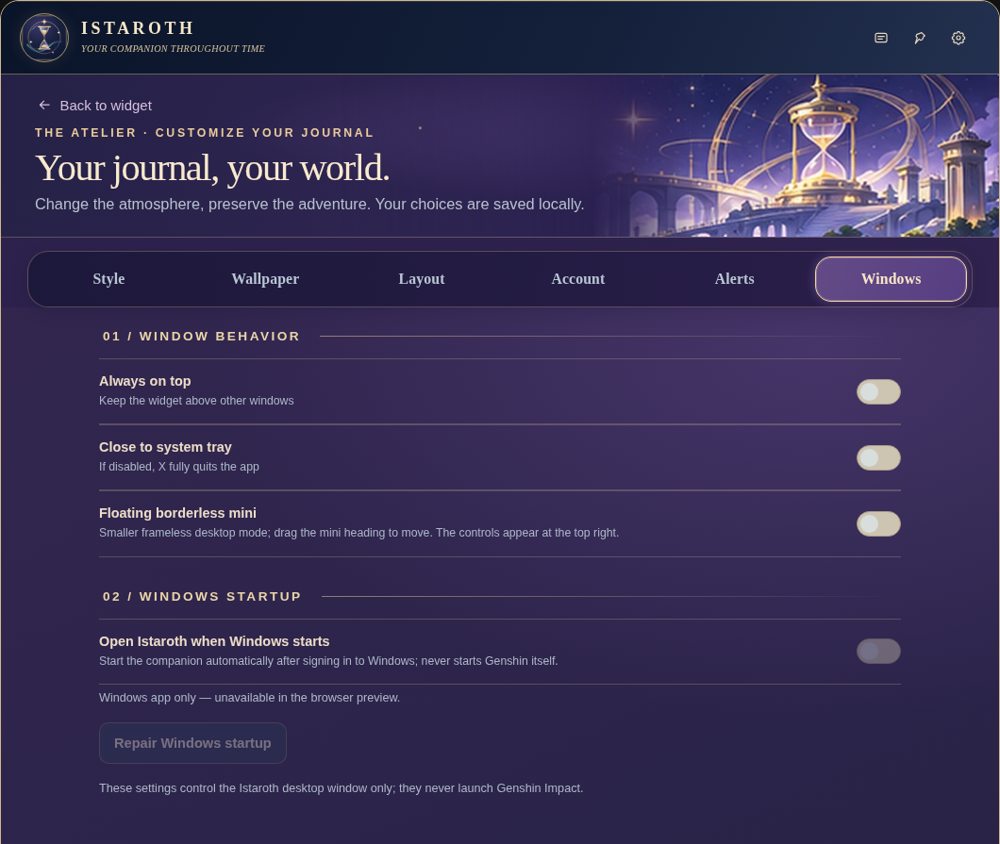

# Istaroth

**Your Companion Throughout Time!**

A free, open-source, unofficial Genshin Impact desktop companion for Windows.

Istaroth displays HoYoLAB information, including Original Resin, dailes, realm currency and more!

> **Current release: v1.0.** The installer is unsigned and has not undergone an independent security audit. HoYoLAB integration relies on unofficial endpoints and may change. Istaroth is not affiliated with or endorsed by HoYoverse or Cognosphere.

## Preview




## Features

- Automatically retrieves Original Resin and available HoYoLAB account information
- Floating Mini Resin Widget, tray resin indicator and recovery timers
- Resin alerts, quiet hours, local history and daily overview
- Account, exploration, combat and TCG information where available
- Nine regional color themes with illustrations in the Style gallery: **Istaroth, Mondstadt, Liyue, Inazuma, Sumeru, Fontaine, Natlan, Nod-Krai and Snezhnaya**
- Custom wallpapers, typography, accent colors, layouts and saved appearance profiles
- Windows autostart, always-on-top, close-to-tray and connection recovery
- Graphical installer with shortcuts and uninstaller, no console window for end users

No manual resin editing or in-app Genshin Impact launching.

## Download and installation

Download the Windows setup executable from this repository's **Releases** page (once published). A first-time installation uses an internet connection to download the official Electron runtime and validates its SHA-256 before extraction.

1. Quit older Istaroth or Teyvat Pulse installations fully, including their system-tray processes.
2. Run Setup and choose the installation folder and Windows-startup preference.
3. Open Istaroth and connect through the official HoYoLAB sign-in page under **Settings → Account**.
4. Use **Settings → Windows** for window and startup behavior, **Settings → Alerts** for notifications, and **Settings → Style** for regional designs.

Requires **Windows 10/11 x64**. The unsigned installer may trigger a Microsoft SmartScreen reputation warning. A separate antivirus detection should be investigated, not bypassed.

## HoYoLAB account security and privacy

Login takes place in the official HoYoLAB browser page in a separate persistent Electron session. Authentication cookies remain in your local Electron user-data profile and are used for authenticated HoYoLAB requests. No Istaroth developer-operated analytics or account server is configured. Do not share your cookies or tokens.

See [Privacy](PRIVACY.md) and [Security](SECURITY.md). Third-party clients carry account and compatibility risks.

## Upgrading from Teyvat Pulse

Istaroth intentionally retains the legacy local profile folder `%APPDATA%\Teyvat Pulse` to preserve signed-in sessions, wallpapers, resin history and saved settings. This is not evidence that the old app is still installed.

## Source and building

The MIT-licensed project includes the Electron application in `app/` and the custom Go Windows graphical installer in `installer/`.

For development (Node.js required), run from `app/`:

```powershell
npm install
npm start
npm run check
npm run test:startup
npm run test:v22
```

To build the Windows Setup from source, install Go and run from `installer/`:

```powershell
go build -ldflags="-H=windowsgui" -o Istaroth_Setup.exe main.go wizard.go
```

The installer embeds `installer/app.zip`. Generate it with `python scripts/build_embedded_app.py` before compiling the installer. CI generates the same archive from source and builds a Windows setup artifact. The published installer SHA-256 confirms the download's bytes; it is not a code signature or a guarantee of safety.

## Artwork and acknowledgements

Regional banner art uses locally bundled, AI-assisted original illustrations inspired by Genshin Impact settings, not official game screenshots. Genshin Impact, its names, and related intellectual property belong to their respective owners. This independent fan project is not officially endorsed.

The project code is [MIT licensed](LICENSE). Do not assume that external game assets, user wallpapers, or trademarks are covered by the source-code license.

[Changelog](CHANGELOG.md) · [Contributing](CONTRIBUTING.md) · [Security](SECURITY.md) · [Code signing policy](CODE_SIGNING.md)

### Wallpaper Studio

Main wallpaper and Mini wallpaper now have their own **top-level settings pages**, with separate image storage, position, blur, darkness, zoom and live previews. Main additionally supports Full Widget / Resin Card placement. Existing wallpaper files are retained.

## Wallpaper editor

Open **Settings → Main wallpaper** or **Settings → Mini wallpaper**. These are different pages, not a two-widget selector inside Main. Each uses separate image storage, sliders, reset and real widget preview. Main's full/card wallpaper target never controls the Mini Widget.
